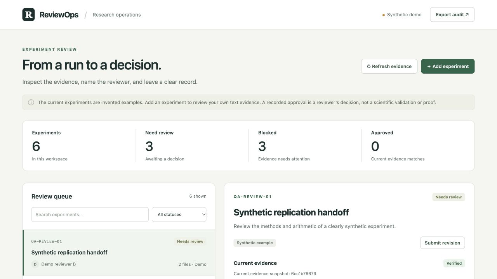

# ReviewOps

[](https://github.com/nealyx/reviewops/actions/workflows/checks.yml)

**Know what was reviewed, which evidence it used, and what needs to happen next.**

ReviewOps is a local experiment-review workspace. Submit a small evidence package,
assign its reviewer, inspect the files, and record a decision. When the experiment
changes, submit a new snapshot: the old files and decision remain readable, and
the new evidence needs a fresh review.

It addresses a common research handoff problem: results live in one folder,
comments live somewhere else, and nobody is sure whether an approval refers to
the latest files.

**Status: working local prototype; researcher pilot pending.** The five startup
runs and generic import example are synthetic. A separate
[published-audit walkthrough](docs/public-audit-walkthrough.md) uses an actual
verification of public EGRA results, with source hashes and no recorded human
decision. This is an independent project built with AI-assisted engineering.
No adoption, time savings, or scientific outcome has been measured.

[Manifest format](docs/manifests.md) · [Design and boundaries](docs/design.md) ·
[Validation and preview](docs/validation.md) · [Researcher pilot](PILOT.md) ·
[Contributing](CONTRIBUTING.md) · [Download a release](https://github.com/nealyx/reviewops/releases)



## Run locally

Python 3.9 or later; no third-party dependencies, accounts, model APIs, or cloud services.

```sh
git clone https://github.com/nealyx/reviewops.git
cd reviewops
python3 app.py --port 8787
```

Open **http://127.0.0.1:8787/**. Stop with Ctrl+C. On macOS,
`launch.command` also starts the app.

Five bundled cases cover valid evidence, a missing file, changed bytes, and an
empty package. They are copied once into `runtime/`; restarting preserves work
and never restores original files over your edits.

For a separate workspace without demonstration records:

```sh
python3 app.py --empty --data-dir ./runtime/my-workspace --port 8788
```

`--empty` affects only an uninitialized directory. It never clears existing records.

## A five-minute walkthrough

1. Open **SYN-001**, read its two evidence files, assign a reviewer, and approve
   with a note explaining what you checked.
2. Open **SYN-002**. Its missing file blocks approval. Record a change request.
3. Use **Add experiment** to submit metadata and small UTF-8 text files. Mark it
   synthetic if it is a demonstration.
4. Approve it, then **Submit revision** with changed evidence. Every revision is
   a complete replacement package. Its status returns to **Needs review**.
5. Open the earlier snapshot: its files and decision remain readable. Export
   the audit to inspect the recorded history outside the app.

An empty package may be submitted as an incomplete handoff; it stays blocked.
Hash verification checks content identity, **not scientific correctness**.
A reviewer still needs to assess the methods, results, and limitations.

You can also import the checked-in synthetic example:

```sh
python3 app.py --empty --data-dir ./runtime/import-demo \
  --import-manifest examples/manifest.json
python3 app.py --data-dir ./runtime/import-demo --port 8788
```

The importer copies only files listed by the selected manifest. Later edits to
the source files do not change the submitted snapshot.
See the [format and revision example](docs/manifests.md).

## Try a published research audit

The [EGRA walkthrough](docs/public-audit-walkthrough.md) shows how a real
saved-output check becomes a reviewable handoff. Its included report verifies
46 public CSV hashes and compares 774 summary values. The package records the
exact source commit, checking program, file-set identity, report, and limits.

```sh
python3 app.py --empty --data-dir runtime/published-audit \
  --import-manifest examples/published-audit/manifest.json
python3 app.py --data-dir runtime/published-audit --port 8790
```

The record starts **Needs review**, unassigned, with four evidence files and one
automated submission event. Importing the report does not rerun the analysis or
approve its conclusions. The walkthrough also provides a recipe to recompute
the checks from the pinned public source and import a fresh report.

## What happens when evidence changes?

| Action | Current status | Historical record |
|---|---|---|
| Submit valid evidence | Needs review | New snapshot and submission event |
| Approve with a note | Approved | Decision references that snapshot |
| Request changes | Changes requested | Request references that snapshot |
| Submit revised evidence | Needs review | Earlier snapshots and decisions retained |
| Modify or remove a stored file outside the app | Blocked | Previous decision retained; mismatch visible |
| Restore the exact approved bytes | Previous approval becomes effective again | No continuous file-change history is claimed |

Each assignment, decision, or submission increments the **record version**.
Only submissions create a new **evidence snapshot**. Stale versions are rejected,
so two open tabs cannot silently overwrite one another's actions.
Each detail, queue, and audit export also reads a consistent database snapshot
when a separate CLI import commits a revision during the request.

## Data and operating limits

This is a **local, single-user tool**. Names are self-reported labels, not
authenticated identities. There is no team server, messaging service, experiment
runner, or GitHub integration. Nothing is uploaded to a cloud service.

- Submissions: 20 UTF-8 text files, 256 KiB per file, 1 MiB total evidence, and
  2 MiB per JSON request. Binary artifacts and large datasets are out of scope.
- Previews show at most the first 32 KiB, as plain text, never executable HTML.
- The server binds to `127.0.0.1`, checks Host/Origin, and requires a local
  request token for writes. Other processes running as your OS user remain
  outside that boundary.
- SQLite triggers reject ordinary updates/deletes to audit events and snapshot
  records. The database owner can bypass those controls; this is not an
  independently witnessed or tamper-proof ledger.
- Files are checked on reads and before approval. There is no continuous watcher;
  another local process can change a file between verification and a response.
- Exports include metadata, manifests, verification, and history. They **do not**
  include evidence file bodies or constitute a restorable backup. Stop the
  server and copy the complete runtime directory to back up a workspace.

`runtime/` is ignored by Git. For a custom data directory, use a location outside
the checkout or add your own ignore rule. Review exports before sharing
user-submitted records.

## Verify

```sh
python3 -m unittest discover -s tests -v
```

For frontend development, Node.js 22 or later can also run the small behavior
regressions without installing packages:

```sh
node --test tests/test_frontend.js
```

Node is not needed to run the app.

The frontend regressions exercise evidence previews, retained decision drafts,
keyboard focus after queue selection and file removal, and recoverable
submission errors using a small DOM model. They do not
replace checking keyboard navigation and layout in a browser.

Tests use temporary directories, synthetic cases, and the explicitly labeled
published-audit package. They cover integrity gates,
retained revisions, approval reset, stale updates, failed-write rollback,
restart persistence, manifest confinement, HTTP boundaries, previews, and export.
The workflow runs on Linux and macOS; its badge reports the latest hosted result.
Software tests do not establish multiuser scale or scientific validity.

## API

`GET /api/state` returns a local `csrf_token`. Writes send it in
`X-ReviewOps-Token` with `Content-Type: application/json`.

| Method | Route | Purpose |
|---|---|---|
| GET | `/api/state` | Queue, events, data indicator, token |
| GET | `/api/runs/<id>` | Details, current evidence, snapshots, history |
| POST | `/api/submissions` | Create or revise a complete evidence package |
| POST | `/api/runs/<id>/assign` | `{owner, actor, expected_version}` |
| POST | `/api/runs/<id>/decision` | `{decision, actor, note, expected_version}` |
| GET | `/api/runs/<id>/evidence/<index>` | Current evidence preview |
| GET | `/api/runs/<id>/snapshots/<snapshot>/evidence/<index>` | Retained evidence preview |
| GET | `/api/export` | Version 2 audit export without the request token |

Decisions are `approved` or `changes_requested`. Effective status may also be
`needs_review` or `blocked`; `recorded_status` preserves the stored review status.
HTTP 400 means invalid input, 403 a request-boundary failure, 404 a missing entry,
409 a stale version, 413 an oversized request, and 422 a failed approval gate.

The next milestone is an observed researcher handoff using permitted examples.
The [pilot guide](PILOT.md) records task success, time, confusion, and changes
supported by feedback. Measured usefulness remains an open question.
