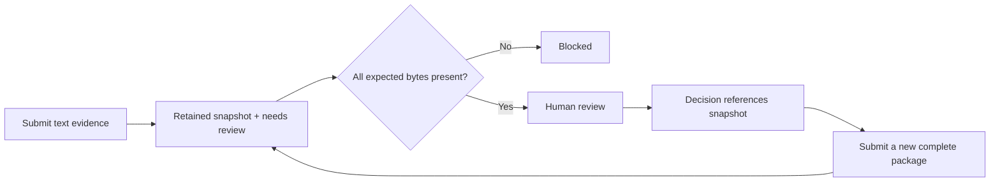

# Design and evidence boundaries

`runs` stores current metadata and review status; `evidence` points to its
current package. `snapshots` retains submitted manifests. `events` records
assignments, submissions, and decisions with their record version and snapshot.

Effective status is computed on reads. Missing, altered, or empty evidence
produces `blocked`, while `recorded_status` preserves the stored decision.
Integrity checking is separate from reviewing scientific methods.

## Why local and dependency-free?

The first question is whether explicit evidence handoffs help a researcher.
Python's standard library and SQLite make the workflow inspectable and quick to
try without provisioning infrastructure or granting access to research systems.
The tradeoff is limited scope: one local operator, serialized requests, small
text artifacts, and no authenticated identities or shared team deployment.

Attachments are never executed. They might be methods notes, small result
tables, command logs, or review checklists. Large arrays, binaries, weights, and
remote storage require a later design.

## Update consistency

Writes supply the version the operator observed. An immediate SQLite transaction
checks that version and commits the state and event together. Stale writes get
HTTP 409.

Evidence previews use the snapshot displayed in the page. If another tab or
import creates a revision, an already-open page still reads its original
snapshot; refreshing loads the newer package. A preview error is shown rather
than silently substituting current evidence. Assignment changes preserve an
unfinished decision note, including when the reviewer is cleared.

Submissions write files into a fresh directory during the transaction. Handled
failures remove that new directory and roll back the database. A process or power
failure can leave an unreferenced directory; there is no automatic cleanup claim.
Filesystem writes and SQLite commits are not one cross-resource atomic operation.

The app retains earlier snapshots. SQLite triggers reject ordinary event and
snapshot updates/deletes, but the database owner can bypass these controls.

## Upgrading the first prototype

Existing databases are extended in place. Legacy manifests receive snapshots
marked `legacy_capture`, retaining their expected hashes. Available files are
copied into retained snapshot storage; missing or changed evidence remains
missing or changed.

Old audit events are not rewritten to claim snapshot references they did not
record. Their `snapshot_id` stays null. A legacy capture records the state
observed on upgrade, not proof of every past file's contents. Subsequent
decisions reference the captured snapshot.

## Browser boundary

The server listens on IPv4 loopback. Host/Origin validation and a random
process-local write token help prevent writes from unrelated websites. The
frontend uses text nodes for submitted content, a restrictive content security
policy, and bounded JSON previews. There is no remote API call.

These controls do not protect against local processes with the same filesystem
permissions, authenticate researchers, or make this server suitable for network
exposure. Shared deployment needs an identity, access, storage, backup, and
operating model informed by actual pilot requirements.

## What would demonstrate value?

Tests establish state transitions and persistence. They do not establish team
fit. The next evidence is a researcher using the tool on a permitted handoff and
comparing it with the current process. See the [pilot protocol](../PILOT.md);
no pilot results have been collected.
