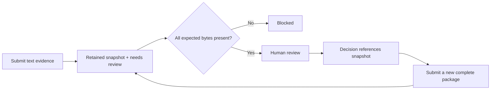

# Design and evidence boundaries

`runs` stores current metadata and review status; `evidence` points to its
current package. `snapshots` retains submitted manifests. `events` records
assignments, submissions, and decisions with their record version and snapshot.

Effective status is computed on reads. Missing, altered, or empty evidence
produces `blocked`, while `recorded_status` preserves the stored decision.
Integrity checking is separate from reviewing scientific methods.

## Why local and dependency-free?

The first question is whether explicit evidence handoffs help a researcher.
Python's standard library and SQLite make the workflow inspectable and quick to
try without provisioning infrastructure or granting access to research systems.
The tradeoff is limited scope: one local operator, serialized requests, small
text artifacts, and no authenticated identities or shared team deployment.

Attachments are never executed. They might be methods notes, small result
tables, command logs, or review checklists. Large arrays, binaries, weights, and
remote storage require a later design.

## Update consistency

Writes supply the version the operator observed. An immediate SQLite transaction
checks that version and commits the state and event together. Stale writes get
HTTP 409.

Detail, queue, and export responses each read one consistent SQLite snapshot.
A separate CLI import can commit while a response is being assembled; the
response still contains either the preceding database state or the following
one, rather than old metadata paired with a new evidence list or data label.
Nested readers share the outer snapshot. This database guarantee does not freeze
file contents against edits by another local process.

Evidence previews use the snapshot displayed in the page. If another tab or
import creates a revision, an already-open page still reads its original
snapshot; refreshing loads the newer package. A preview error is shown rather
than silently substituting current evidence. Assignment changes preserve an
unfinished decision note, including when the reviewer is cleared.

Decision drafts are stored separately for each experiment in tab memory.
Selection captures the departing note only when the requested record finishes
loading, preserving typing during the request. Refreshing to a different
evidence snapshot keeps the draft and displays its older-evidence warning.
A successful decision clears only the submitted text, not new text typed
while the write was pending. Reloading or closing the page clears drafts.

The comparison view selects the immediately preceding submission by its record
version, rather than treating assignment or decision versions as evidence
changes. It compares the recorded filenames and expected hashes; previews
remain bound to both selected snapshot IDs and separately verify stored bytes.
Metadata comparisons use values at submission, not later reviewer assignments.

Each preview hashes and retains its text prefix from one opened file stream.
Replacing a file between separate hash and preview reads therefore cannot
mislabel replacement text as verified. The full file is checked up to the 8 MiB
limit, even though only the first 32 KiB is displayed. This does not freeze the
path's contents after the read or prevent outside edits.

Submissions write files into a fresh directory during the transaction. Handled
failures remove that new directory and roll back the database. A process or power
failure can leave an unreferenced directory; there is no automatic cleanup claim.
Filesystem writes and SQLite commits are not one cross-resource atomic operation.

The app retains earlier snapshots. SQLite triggers reject ordinary event and
snapshot updates/deletes, but the database owner can bypass these controls.

## Upgrading the first prototype

Existing databases are extended in place. Legacy manifests receive snapshots
marked `legacy_capture`, retaining their expected hashes. Available files are
copied into retained snapshot storage; missing or changed evidence remains
missing or changed.

Old audit events are not rewritten to claim snapshot references they did not
record. Their `snapshot_id` stays null. A legacy capture records the state
observed on upgrade, not proof of every past file's contents. Subsequent
decisions reference the captured snapshot.

## Browser boundary

The server listens on IPv4 loopback. Host/Origin validation and a random
process-local write token help prevent writes from unrelated websites. The
frontend uses text nodes for submitted content, a restrictive content security
policy, and bounded JSON previews. There is no remote API call.

The serialized request handler gives accepted sockets a five-second inactivity
timeout before reading headers. It also rejects an incomplete or stalled body
before parsing or submitting any data. This bounds an idle connection's hold on
the server without introducing concurrent access to its SQLite connection.
Continuously arriving data can extend the request; this is not a total deadline
or protection against other processes controlled by the local user.

These controls do not protect against local processes with the same filesystem
permissions, authenticate researchers, or make this server suitable for network
exposure. Shared deployment needs an identity, access, storage, backup, and
operating model informed by actual pilot requirements.

## What would demonstrate value?

Tests establish state transitions and persistence. They do not establish team
fit. The next evidence is a researcher using the tool on a permitted handoff and
comparing it with the current process. See the [pilot protocol](../PILOT.md);
no pilot results have been collected.
